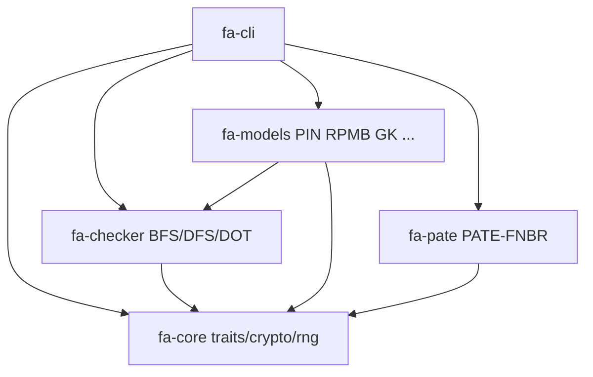

# Architecture

## Crates

| Crate | Rol |
|-------|-----|
| `fa-core` | `Model`/`State`/`Action`/`Property`/`Mutant`, crypto, RNG, prereg |
| `fa-checker` | exploración, contraejemplos, DOT |
| `fa-models` | mecanismos + mutantes + adapters pin/rpmb |
| `fa-pate` | transcripción hash-encadenada |
| `fa-cli` | `fa` / `forense-artefactos` / `fa-bench` |

MSRV: **1.85** (workspace `rust-version`).
